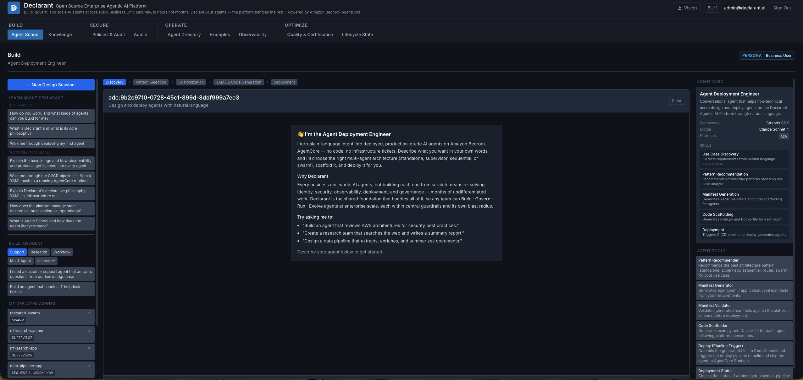
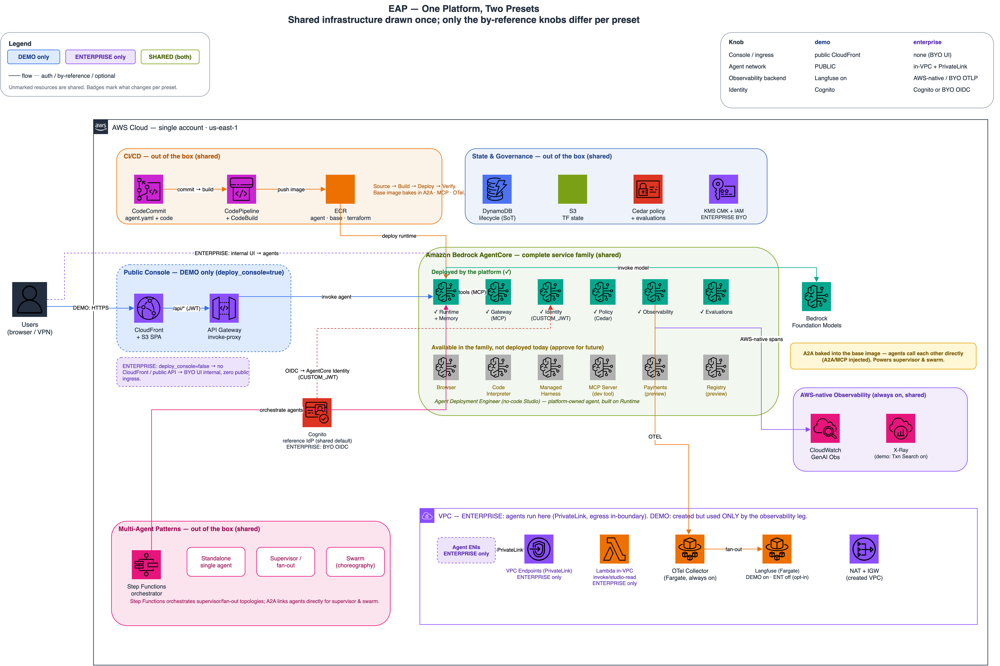
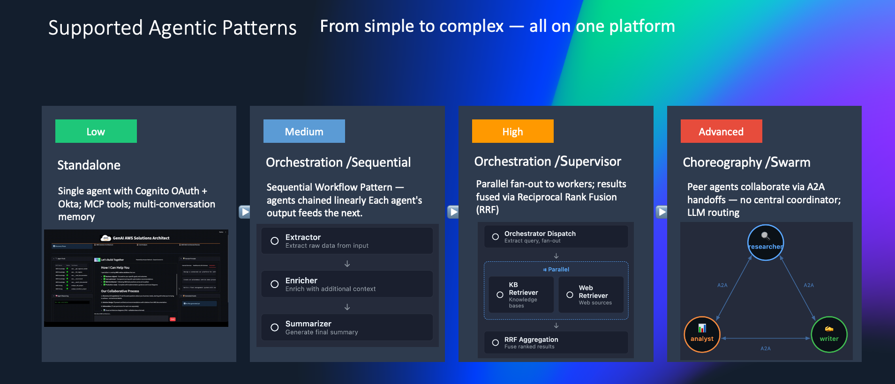
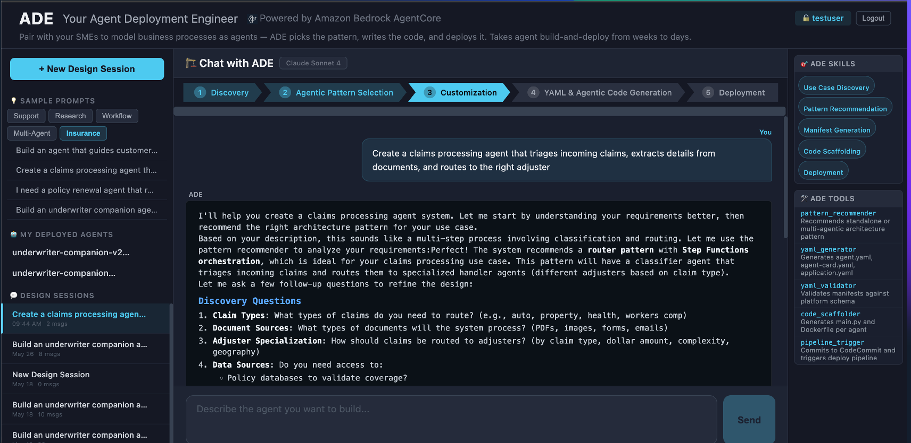

# Enterprise Agentic AI Platform (EAP)

_An open-source, declarative agentic AI platform · Build · Govern · Run · Evolve · Powered by Amazon Bedrock AgentCore_

<p align="center">
  
</p>

> [!IMPORTANT]
> **Sample code, not for production.** This repository is provided for instructional purposes and to demonstrate the art of the possible. Deploy it only into a dedicated, non-production AWS account, with no real customer, personal or regulated data. It is not hardened for production use. See the [threat model](docs/security/THREAT-MODEL.md) for known risks and the changes you should make before running anything like it in production. You are responsible for the AWS costs it incurs; tear it down when you are done (`test/demo-testbed/99-teardown.sh` or `test/enterprise-testbed/99-teardown.sh`).

> **Tip:** Starring this repo helps more developers discover EAP.

## Business Overview

Every business unit wants AI agents — for customer service, IT operations, research, compliance. But building each agent from scratch means every team solves the same problems: identity, security, observability, deployment, governance. That's months of undifferentiated work before a single agent goes live.

This platform eliminates that. It's a shared foundation that any team can use to build, deploy, and govern AI agents at enterprise scale. Teams describe what they want in simple YAML manifests. The platform handles everything else — infrastructure, identity, safety guardrails, CI/CD, monitoring.

**Why it matters:**

| Benefit | What it means |
|---------|---------------|
| Faster time to market | Agents go from idea to production in hours, not months. Pre-built patterns, automated CI/CD, and Agent Builder Studio for no-code creation. |
| Consumption-based pricing | Pay only for active CPU processing — not while agents wait for LLM responses or API calls (typically 70% of execution time). No upfront commitments, scales to zero when idle. [See pricing details](https://aws.amazon.com/blogs/machine-learning/securely-launch-and-scale-your-agents-and-tools-on-amazon-bedrock-agentcore-runtime/). |
| Security building blocks | Session isolation between users (AgentCore Runtime), authentication with Cognito or your corporate identity provider, verified JWTs on every backend, and Cedar policies for tool access. Some controls need extra setup before production; see [LLM Safety and Guardrails](#llm-safety-and-guardrails) and the [threat model](docs/security/THREAT-MODEL.md). |
| Framework and model agnostic | Use any agent framework (Strands, LangGraph, CrewAI, custom) and any foundation model (Anthropic, Meta, Mistral, Amazon). No vendor lock-in. |
| Built-in observability | Every agent gets distributed tracing, CloudWatch metrics, and X-Ray spans automatically (AWS-native, always on). A private in-VPC OTel collector fans spans out to a pluggable backend — self-hosted Langfuse by default (private, no public exposure) or an external OTLP backend (Datadog/Fiddler) by config. No instrumentation code needed. |
| Federated governance | AI Governance defines policies centrally (Cedar policies, graduation thresholds, evaluations) and each BU deploys within them. Agents built with the ADE need a reviewer's approval before they deploy. |
| Serverless and scalable | No infrastructure to manage. AgentCore handles auto-scaling, session isolation, and long-running workloads up to 8 hours. |

One platform, built once, vended to every business unit. Each BU operates independently within platform guardrails — own agents, own data connections, own identity, own blast radius.

Built on [Amazon Bedrock AgentCore](https://aws.amazon.com/bedrock/agentcore/) — a fully managed, serverless infrastructure for deploying and operating AI agents at scale.

### Quick Deploy

One interactive command stands up the platform end-to-end — bootstrap → seed images → `terraform apply` → seed the example agents → validate — with a single confirmation:

```bash
cd test/demo-testbed && ./run-all.sh          # public demo (public console + Examples surface + Langfuse)
cd test/enterprise-testbed && ./run-all.sh    # hardened — no public console, agents in-VPC
# add --yes to skip the prompt (CI/unattended)
```

Prereqs: `terraform`, `aws` CLI v2, `node`/`npm`, and a running Docker daemon (the base + Agent Deployment Engineer images are seeded on first deploy). The two presets follow [ADR-036](docs/adr/036-two-preset-model.md); `enterprise` deploys the self-contained base — bring-your-own VPC/OIDC/OTLP/CMK/roles are override blocks in `enterprise.tfvars`. Tear down with `./99-teardown.sh` in the same directory.

> **Full procedure + prerequisites:** [`platform/DEPLOY-RUNBOOK.md`](platform/DEPLOY-RUNBOOK.md) (one-time account enablement, step-by-step, teardown).

## Enterprise Architecture — What Gets Deployed

**For EA / cloud-service review.** Everything is provisioned by Terraform — **no
click-ops, no ad-hoc AWS CLI resource creation**. A default deploy creates only
these AWS service families, in the customer's chosen account/region:

- **Amazon Bedrock AgentCore** — Runtime, Gateway, Memory, Identity (CUSTOM_JWT+OIDC), Observability, Policy (Cedar), Evaluations *(the full 13-service family can be pre-approved; 7 are deployed by default)*
- **Amazon Bedrock** — foundation-model invocation (Claude Sonnet 5 inference profile), scoped IAM
- **CI/CD** — CodeCommit (source), CodePipeline V2 (orchestration), CodeBuild (ARM64 build / `terraform apply` / verify)
- **Amazon ECR** — agent, base, and Terraform build images (scan-on-push + lifecycle)
- **Amazon ECS/Fargate + ALB** — the always-on ADE streaming chat backend ([ADR-040](docs/adr/040-ade-streaming-invoke-backend.md); internal ALB in enterprise, CloudFront-fronted in demo)
- **Amazon DynamoDB** — deployed-agent lifecycle store (single source of truth)
- **Amazon Cognito** — user pool / app client / resource servers *(skipped entirely when an external OIDC IdP is supplied — [ADR-028](docs/adr/028-deployer-supplied-oidc.md))*
- **Amazon CloudWatch + AWS X-Ray** — AWS-native agent observability, on by default
- **AWS Lambda, SSM Parameter Store, IAM** — console API backend / commit validation, collector-endpoint discovery, least-privilege per-BU roles
- **Demo-only public ingress** — Amazon CloudFront + Amazon API Gateway + S3 (removed entirely in `enterprise` via `deploy_console=false`, [ADR-034](docs/adr/034-optional-demo-console.md))

**Networking:** agents run in-VPC by default (private subnets + PrivateLink to
AgentCore) — the enterprise, no-public-egress posture ([ADR-031](docs/adr/031-agent-workloads-in-vpc.md)).
**CI/CD is swappable:** the AWS-native CodePipeline/CodeBuild/CodeCommit reference
can be replaced with another CI/CD system without changing the agent contract.

> **Full EA table** — exact named resources per service, per environment — is in
> the runbook's *Enterprise Architecture Approval* section:
> [`platform/DEPLOY-RUNBOOK.md`](platform/DEPLOY-RUNBOOK.md).

## FinOps — Cost Model

**For FinOps review.** The cost *model* is consumption-first; the durable
principles are below. **Dollar figures live only in the runbook** so there is a
single source of truth to keep current as AWS pricing and usage assumptions
change — this section deliberately carries no hardcoded amounts.

- **Standing (idle) cost is minimal and predictable.** The only always-on
  compute is the ADE streaming chat backend (one Fargate task + ALB —
  [ADR-040](docs/adr/040-ade-streaming-invoke-backend.md)); it can be dropped to return idle to storage-only (mostly
  ECR images). Everything else is consumption-priced and $0 when idle.
- **Run cost is dominated by model tokens.** Per-invocation cost is
  overwhelmingly Bedrock LLM inference; platform + AgentCore overhead is a small
  fraction. Volume scales linearly.
- **No upfront commitment; scale-to-zero.** AgentCore runtime bills only when
  invoked (I/O wait is free). Biggest cost levers: prompt/context size, loop
  count, model choice, and prompt caching.

> **Current cost figures** — standing (idle) monthly estimate, per-invocation /
> POC run-cost breakdown, and the price-snapshot date — are maintained in the
> runbook's *FinOps* section: [`platform/DEPLOY-RUNBOOK.md`](platform/DEPLOY-RUNBOOK.md).
> Those are AWS list-price estimates as of a stated date — reconcile against your
> org EDP and re-check against current AWS pricing.

## Platform Operating Model

```
┌─────────────────────────────────────────────────────────────────────────────────────┐
│                       ENTERPRISE AGENTIC AI PLATFORM                                │
│                            Operating Model                                          │
├─────────────────────────────────────────────────────────────────────────────────────┤
│                                                                                     │
│  👤 PERSONAS                                                                        │
│                                                                                     │
│  ┌────────────┐ ┌────────────┐ ┌────────────┐ ┌────────────┐ ┌──────────┐ ┌──────┐│
│  │ Platform   │ │ BU Admin   │ │AI Governance│ │ Developer  │ │ Business │ │ Data ││
│  │ Engineer   │ │            │ │  & Risk     │ │            │ │ User     │ │ Eng  ││
│  └─────┬──────┘ └─────┬──────┘ └─────┬──────┘ └─────┬──────┘ └────┬─────┘ └──┬───┘│
│        │              │              │              │             │           │     │
│        ▼              ▼              ▼              ▼             ▼           ▼     │
│  ┌──────────┐  ┌──────────┐  ┌──────────┐  ┌──────────┐  ┌──────────┐ ┌─────────┐ │
│  │ BUILDS & │  │CONFIGURES│  │  SETS    │  │ WRITES   │  │  USES    │ │CONNECTS │ │
│  │MAINTAINS │  │ DOMAINS  │  │ POLICIES │  │ CODE +   │  │  AGENT   │ │  DATA   │ │
│  │ PLATFORM │  │& POLICIES│  │& GUARD-  │  │  YAML    │  │ BUILDER  │ │ SOURCES │ │
│  │ (once)   │  │ (per BU) │  │  RAILS   │  │          │  │ STUDIO   │ │         │ │
│  └──────────┘  └──────────┘  └──────────┘  └──────────┘  └──────────┘ └─────────┘ │
│                                                                                     │
│  🔧 PLATFORM PRODUCT (built once, vended many times)                                │
│                                                                                     │
│  ┌───────────────────────┐  ┌───────────────────────┐  ┌───────────────────────┐   │
│  │ 🏗️ INFRASTRUCTURE      │  │ 🛡️ GOVERNANCE          │  │ 🤖 AGENT RUNTIME       │   │
│  │                       │  │                       │  │                       │   │
│  │ • CI/CD Pipelines     │  │ • Agent Evaluations   │  │ • AgentCore Runtime   │   │
│  │ • Base Images         │  │ • Safety Guardrails   │  │ • Multi-Agent         │   │
│  │ • Infra as Code       │  │ • Audit Trail         │  │   Orchestration       │   │
│  │ • Deploy Templates    │  │ • Model Approvals     │  │ • Agent Memory        │   │
│  │                       │  │ • Cedar Policies      │  │ • Agent Builder       │   │
│  │                       │  │                       │  │   Studio              │   │
│  └───────────────────────┘  └───────────────────────┘  └───────────────────────┘   │
│                                                                                     │
│  ─ ─ ─ ─ ─ ─ ─ ─ ─ ─ ─ ─ ─ ─ ─ ─ ─ ─ ─ ─ ─ ─ ─ ─ ─ ─ ─ ─ ─ ─ ─ ─ ─ ─ ─ ─ ─   │
│                        Amazon Bedrock AgentCore                                     │
├─────────────────────────────────────────────────────────────────────────────────────┤
│                                                                                     │
│  📦 PLATFORM INSTANCES (one per BU, LOB, or team)                                   │
│                                                                                     │
│  ┌───────────────────────────────────────┐  ┌───────────────────────────────────┐   │
│  │ BU: Sales                             │  │ BU: Operations                    │   │
│  │                                       │  │                                   │   │
│  │ ┌─────────────────────────────────┐   │  │ ┌─────────────────────────────┐   │   │
│  │ │ Agents & Orchestration          │   │  │ │ Agents & Orchestration      │   │   │
│  │ │ • Own agents, pipeline, IAM     │   │  │ │ • Own agents, pipeline, IAM │   │   │
│  │ └─────────────────────────────────┘   │  │ └─────────────────────────────┘   │   │
│  │ ┌─────────────────────────────────┐   │  │ ┌─────────────────────────────┐   │   │
│  │ │ 🔌 Shared Services (horizontal) │   │  │ │ 🔌 Shared Services           │   │   │
│  │ │ • Identity (Cognito group)      │   │  │ │ • Identity (Cognito group)  │   │   │
│  │ │ • Observability (CW, X-Ray)     │   │  │ │ • Observability (CW, X-Ray) │   │   │
│  │ └─────────────────────────────────┘   │  │ └─────────────────────────────┘   │   │
│  │ ┌─────────────────────────────────┐   │  │ ┌─────────────────────────────┐   │   │
│  │ │ 🗄️ Data Services (horizontal)    │   │  │ │ 🗄️ Data Services             │   │   │
│  │ │ • MCP Gateway + targets         │   │  │ │ • MCP Gateway + targets     │   │   │
│  │ │ • Enterprise connectors         │   │  │ │ • Enterprise connectors     │   │   │
│  │ │ • Data entitlements (3LO)       │   │  │ │ • Data entitlements (3LO)   │   │   │
│  │ └─────────────────────────────────┘   │  │ └─────────────────────────────┘   │   │
│  └───────────────────────────────────────┘  └───────────────────────────────────┘   │
│                                                                                     │
│  ┌───────────────────────────────────────┐  ┌───────────────────────────────────┐   │
│  │ BU: Commercial                        │  │ BU: ...                           │   │
│  │  (same structure as above)            │  │  (same structure as above)        │   │
│  └───────────────────────────────────────┘  └───────────────────────────────────┘   │
│                                                                                     │
└─────────────────────────────────────────────────────────────────────────────────────┘
```

## Architecture at a Glance

A few core ideas define how the platform is structured. Everything else follows
from them.

### 1. Everything is a repo — split by ownership into `platform/` and `users/`

Every interaction with the platform happens through a **git repo wired to a
CI/CD pipeline** — never by touching infrastructure directly. Repos are grouped
at the workspace root by **who owns them**:

- **`platform/` — the platform product + blueprint** (owned by Platform
  Engineering / Operator; the only place Terraform is written):
  - `eap-terraform-modules/` — reusable modules (1:1 per AgentCore
    primitive), base images, deploy-templates. *The product / interface.*
  - `eap-platform/` — the composed blueprint that a Platform Operator
    `terraform apply`s to stand up one **instance** per BU/account.
  - `console/` — platform-owned unified console SPA.
- **`users/` — platform-user / tenant repos** (owned by the respective persona;
  **zero Terraform** — YAML, policy, or agent code only):
  - `governance/` (AI Governance), `mcp-integrations/` (Data Engineer),
    `knowledge-bases-{bu}/` (GenAI Data Engineer), `team-{name}/` (App Developer).

**Naming rule:** the `eap-` prefix denotes the platform **product**
(`eap-terraform-modules`, `eap-platform`). Platform-user repos are
**unprefixed**, named by role/tenant. Adding a capability = onboarding a new
repo + module + pipeline, never growing a monolith. See
[ADR-029](docs/adr/029-repo-layout-platform-vs-users.md).

> **Blueprint vs. instance:** `eap-terraform-modules` is the reusable
> *product*; `eap-platform` is the *blueprint* (product composed into the
> full architecture); a **deployed instance** is what `terraform apply` of that
> blueprint materializes in one AWS account. One blueprint, many instances.

### 2. External core components are integrated *by reference* — with a platform default

Identity, observability backend, and networking are **external integrations**,
not things the platform hardcodes. Each follows the same contract: **supply your
own → the platform uses it; leave it empty → the platform provisions a private
default.**

| Integration | Bring your own (set this) | Platform default (leave empty) | Decision |
|---|---|---|---|
| **Identity (OIDC)** | `oidc_discovery_url` (any OIDC identity provider) | Provisions Amazon Cognito | [ADR-028](docs/adr/028-deployer-supplied-oidc.md) |
| **Observability backend** | `otel_backend_endpoint` (Datadog / Fiddler / any OTLP) | Self-hosted Langfuse (private, internal HTTP) | [ADR-030](docs/adr/030-observability-private-pluggable.md) |
| **Network (VPC)** | `vpc_id` + `private_subnet_ids` + `public_subnet_ids` | Creates a VPC with full egress (IGW + NAT + private routes) | [ADR-030](docs/adr/030-observability-private-pluggable.md) |
| **Agent network posture** | _(always in-VPC)_ | `"VPC"` — agents run **in the resolved VPC** (private subnets + PrivateLink); both presets use this | [ADR-031](docs/adr/031-agent-workloads-in-vpc.md) |
| **Console / public ingress** | `deploy_console = false` — host your own UI internally (BYO UI); removes CloudFront + API Gateways + Lambdas (the platform's entire public ingress) | Bundled demo console (S3 + CloudFront) + `invoke-proxy` API + `studio-read` routes | [ADR-034](docs/adr/034-optional-demo-console.md) |

The in-VPC **OTel collector is always deployed** and fans agent spans out to the
chosen backend(s); the **AWS-native leg** (CloudWatch/X-Ray) is always on and
independent. When an external IdP is supplied, Cognito is skipped entirely; when
an external OTLP backend is supplied, it fans out alongside Langfuse (`add`) or
replaces it (`replace`). This is an **enterprise, no-public-access** posture:
Langfuse and the collector are private (VPN/corp-network reachable only), and
with `deploy_console=false` the bundled console and its API-Gateway ingress are
removed entirely (BYO UI hosted internally) — so a fully locked-down instance
has **zero** public endpoints.

### 3. Deployment presets — `demo` and `enterprise`

The above knobs are pre-composed into **two** preset `.tfvars` files under
[`platform/eap-platform/configs/`](platform/eap-platform/configs/):
`demo` (show it works) and `enterprise` (hardened, no public ingress). Apply one
with `terraform apply -var-file=configs/<preset>.tfvars` (see the
[deployment runbook](platform/DEPLOY-RUNBOOK.md) for prerequisites and the
step-by-step). A bare `terraform apply` (no `-var-file`) is the `demo` posture.

| Preset | Console | Agent traffic | VPC | Observability | Identity | IAM roles | Public endpoints |
|---|---|---|---|---|---|---|---|
| **`demo`** | Public CloudFront console | In-VPC (private subnets) — same as enterprise | Platform-created — **hosts agents + observability** | Self-hosted Langfuse (private) | Cognito (reference) | Platform-created | Console + Cognito hosted UI |
| **`enterprise`** | Off (BYO UI internal) | In-VPC (private subnets) | Platform-created by default, or **import your own** | AWS-native by default; override to private Langfuse or **your OTLP backend** | Cognito reference, or **your external OIDC** | Platform-created, or **externalized (BYO ARNs)** | Cognito hosted UI only → **zero** once your IdP is wired |

`demo` = show it works · `enterprise` = prove/run it inside the enterprise
network. `enterprise` is **self-contained by default** (platform creates the VPC
+ IAM roles, uses reference Cognito — the former "POC" stage, as-is pending EA
approval) and **hardens progressively** via override blocks in
`enterprise.tfvars` — bring your own VPC, external OIDC IdP, OTLP backend, CMK,
and pre-created roles (the former "pilot" stage). "POC" and "Pilot" are now
maturity stages of this one preset, not separate files. See
[ADR-036](docs/adr/036-two-preset-model.md) and
[ADR-034](docs/adr/034-optional-demo-console.md).

**Agents run inside the enterprise boundary by default.** Every AgentCore
runtime (the platform-owned Studio/ADE agent and every pipeline-deployed
app-team agent) attaches its ENIs in the resolved VPC's private subnets, and the
managed AgentCore APIs (Gateway, Memory, Identity) are reached privately over
**PrivateLink** — so agent egress never leaves the network boundary. This is the
posture the AWS Config rule `BEDROCKAGENTCORE_RUNTIME_PRIVATE_NETWORK_REQUIRED`
expects, and **both presets use it** — `demo` no longer runs agents publicly
(a public agent can't reach in-VPC services like the OTel collector). A legacy
`agent_network_mode = "PUBLIC"` escape hatch still exists but is deprecated and
slated for removal.
See [ADR-031](docs/adr/031-agent-workloads-in-vpc.md).

### 4. YAML in, infrastructure out

Platform users declare intent in YAML (`agent.yaml`, gateway targets,
`kb.yaml`, Cedar policies); pipelines read it via `yamldecode()` and the
platform owns all Terraform. Cross-cutting concerns (identity, observability,
governance, protocols) are injected transparently — users never write HCL.

### 5. State lives in three layers — DynamoDB is the operational state store

The platform never invents a fourth place to keep state. Every fact lives in
exactly one of three layers, by role:

| Layer | Where | Role |
|---|---|---|
| **Desired state** | Git / CodeCommit (the repos) | What *should* exist — declared intent (YAML, HCL, policy). |
| **Provisioning ledger** | Terraform state (S3, per-account) | What Terraform *has* provisioned — the apply-time record. |
| **Operational state** | **DynamoDB** (Agent School lifecycle table) | What is *actually deployed and running* — the read-model the live platform queries (runtime ARNs, app grouping, entrypoints). |

DynamoDB is the **single operational state store** the running platform reads
from — the authoritative read-model for deployed-agent facts (the console,
invoke-proxy, and pipelines all read it). Deploy pipelines record observed state
into it on every deploy. A **reconciler** (scheduled scan of live runtimes vs.
recorded state) to close the drift/convergence gap is future work — DynamoDB
here is an operational projection, not a continuously-reconciled control-plane
store. See [ADR-026](docs/adr/026-platform-state-architecture.md).

**Where SSM fits:** it is *not* a state store and holds *no* deployer inputs.
Inputs (IdP, observability backend, VPC) flow as **Terraform variables**, and
operational state lives in DynamoDB. SSM holds exactly **one** value — the OTel
**collector endpoint** — because it is the one piece of *boot-time config* a
running agent container resolves outside any Terraform apply (a single scoped
`ssm:GetParameter`). That is the whole of SSM's footprint.

---

## Personas

| Persona | Role | What they write | Repo |
|---------|------|-----------------|------|
| Platform Engineering | Builds the platform product — modules, deploy-templates, base images | Terraform (HCL) | `eap-terraform-modules` |
| Platform Operator | Configures and operates platform instances per BU | Terraform (HCL) | `eap-platform` |
| BU Admin | Configures domains, policies, model access for their BU | `bu-config.yaml` | `eap-platform` |
| AI Governance & Risk | Sets safety guardrails, evaluation thresholds, model approvals, audit | Cedar policies, eval configs | `governance` |
| Developer (App Team) | Builds and deploys agents using code + YAML | `agent.yaml`, Dockerfile, Python | `team-{name}` |
| Business User | Creates agents via Agent Builder Studio (no code) | Natural language | Agent Builder Studio UI |
| Data Engineer | Registers enterprise data sources as MCP Gateway targets | `*.yaml` — MCP, Lambda, REST refs | `mcp-integrations` (`mcp/`) |
| GenAI Data Engineer | Creates and manages Bedrock Knowledge Bases for RAG | `kb.yaml`, `data-sources.yaml` | `knowledge-bases-{bu}` |
| QA Engineer | Authors LLM-as-judge evaluators and ground truth datasets | `evaluator.yaml`, `test-cases.jsonl` | `qa-{bu}` |

## Platform Vision


#### Enterprise Agentic AI Platform — Strategic Vision & Implementation on Amazon Bedrock AgentCore

_Click the image to open it full size._

[](docs/diagrams/Platform%20Implementation%20Using%20AgentCore.png)

## How It Works

AgentCore provides foundational services — Runtime, Gateway, Memory, Identity, Policy, Observability, Evaluations, Code Interpreter, and Browser — for building and running AI agents. The platform exposes each AgentCore primitive as a dedicated Terraform module (1:1 mapping) and adds a governance layer that handles cross-cutting concerns transparently.

App teams write `agent.yaml` manifests declaring what their agent needs. They push to their CodeCommit repo and the platform handles the rest. The deploy-template auto-discovers all `agent.yaml` files via `yamldecode()`, provisions AgentCore runtimes, and injects identity, observability, and governance.

Data teams write YAML target definitions (MCP servers, Lambda refs) in the mcp-integrations repo. The gateway pipeline reads these and provisions AgentCore Gateway targets automatically.

**App teams write YAML — platform owns all Terraform.**

## Architecture

```
┌──────────────────────────────────────────────────────────────────────┐
│                    ENTERPRISE AGENTIC AI PLATFORM                    │
├──────────────────────────────────────────────────────────────────────┤
│  VERTICALS                                                           │
│  ┌─ Agent Lifecycle ──────┐  ┌─ Data Layer ────────────────────┐    │
│  │  Delivery (CodePipeline)│  │  Gateway / MCP Servers          │    │
│  │  Memory, Evaluations    │  │  Data Entitlements (3LO)        │    │
│  │  Code Interpreter       │  │  Connectors (Lambda, REST, MCP) │    │
│  │  Browser, Auto-Scaling  │  └─────────────────────────────────┘    │
│  └─────────────────────────┘                                         │
│  HORIZONTALS (injected transparently)                                │
│  ┌─ Protocols ─────────────────────────────────────────────────┐    │
│  │  A2A │ MCP │ HTTP │ Base image injection                    │    │
│  ├─ Identity & Policy (pluggable IdP) ───────────────────────────┤  │
│  │  oidc_discovery_url → external IdP │ else Cognito │ CUSTOM_JWT │  │
│  ├─ Governance ────────────────────────────────────────────────┤    │
│  │  AWS Config Rules │ SCPs │ IAM Access Analyzer              │    │
│  ├─ Observability (private + pluggable) ───────────────────────┤    │
│  │  AWS-native: AgentCore Obs │ CloudWatch │ X-Ray (always on) │    │
│  │  In-VPC OTel Collector → Langfuse (default) │ Datadog/Fiddler│    │
│  ├─ Infrastructure ────────────────────────────────────────────┤    │
│  │  Module Library │ ECR │ State Management │ Drift Detection  │    │
│  └─────────────────────────────────────────────────────────────┘    │
└──────────────────────────────────────────────────────────────────────┘
```

#### Solution Architecture — Demo & Enterprise presets on AWS

One platform, two presets ([ADR-036](docs/adr/036-two-preset-model.md)): the shared
infrastructure is drawn once; only the by-reference knobs (console/ingress, agent
network, observability backend, identity) differ per preset. Source:
[`docs/diagrams/eap-architecture-combined.drawio`](docs/diagrams/eap-architecture-combined.drawio).



## Key Design Principles

- **No higher-level abstractions** — modules map 1:1 to AgentCore primitives
- **YAML in, infrastructure out** — App teams write `agent.yaml`, data teams write target YAML. Platform owns all Terraform
- **Config-driven deployments** — pipelines read YAML via `yamldecode()`, provision resources automatically
- **One product, many instances** — platform is vended per BU into separate AWS accounts
- **IdP-agnostic** — CUSTOM_JWT auth with OIDC discovery URL. Swap identity providers by changing one URL
- **Clear blast radius** — each repo has one owner, one purpose, one deployment scope
- **Least-privilege IAM** — AWS-documented execution role policy for agent runtimes
- **Loose coupling via indirection** — agents reference dependencies by name, not ARN. Gateway resolves targets at runtime; evaluators are discovered dynamically from the state store. Teams deploy in any order. No cross-repo deployment coordination needed.

## Terraform Module Library

| Module | AgentCore Primitive | Consumer |
|--------|---------------------|----------|
| `modules/runtime` | Runtime | Platform (deploy-template) |
| `modules/memory` | Memory | Platform (deploy-template) |
| `modules/gateway` | Gateway | Platform (gateway-deploy-template) |
| `modules/evaluations` | Evaluations | Platform (deploy-template) |
| `modules/pipeline` | _(platform)_ | Platform Operator |
| `modules/gateway-pipeline` | _(platform)_ | Platform Operator |

## Repository Structure

Grouped by ownership (see [Architecture at a Glance](#architecture-at-a-glance)).
`platform/` = the product (Terraform); `users/` = tenant repos (YAML/policy/code,
zero Terraform).

**`platform/` — platform product + blueprint (Platform Eng / Operator):**

| Repository | Owner | Contents |
|------------|-------|----------|
| `platform/eap-terraform-modules` | Platform Engineering | Module library, base images, deploy-templates, buildspecs, pipeline scripts |
| `platform/eap-platform` | Platform Operator | Identity (Cognito or external OIDC), domains, ECR, pipelines, source repos, lifecycle store, observability (collector/Langfuse), VPC, state backend |
| `platform/console` | Platform | Unified console SPA (Build/Govern/Run/Evolve) |

**`users/` — platform-user / tenant repos (no Terraform):**

| Repository | Owner | Contents |
|------------|-------|----------|
| `users/governance` | AI Governance | Graduation policy, red-team prompts, Cedar policies, graduation-policy schema |
| `users/mcp-integrations` | Data Team + GenAI Devs | Gateway target YAML (MCP servers, Lambda, REST) |
| `users/knowledge-bases-{bu}` | GenAI Data Engineer | Bedrock Knowledge Base configs — one folder per KB (`kb.yaml`, `data-sources.yaml`); deployed by `kb-{bu}-deploy` |
| `users/team-{name}` | Developer | Agent code, Dockerfile, `agent.yaml`, `agent-card.yaml`, `application.yaml` |
| `users/qa-{bu}` | QA Engineer | LLM-as-judge evaluator configs, ground truth datasets, domain-specific red-team prompts |

## Extensibility — Onboarding a New Repo as an Extension Point

The platform is deliberately extensive: new capabilities are added not by growing
a monolith but by **onboarding a new source repo, owned by the team responsible
for it**. Each repo is a clean separation-of-concerns boundary — one owner, one
purpose, one blast radius — wired to the platform through a Terraform module and
its own CI/CD pipeline.

For example, to bring on a **third-party MCP provider**, you give them their own
CodeCommit repo as an extension point (rather than mixing their integrations into
an existing team's repo), so their changes deploy — and fail — in isolation.

The onboarding pattern is the same one every existing repo already follows
(`team-bu-1`, `mcp-integrations`, `knowledge-bases-{bu}`,
`qa-{bu}`, `governance`):

1. **Create the repo + assign ownership.** Add it to the platform's source-repo
   configuration so Terraform provisions the CodeCommit repo, IAM access boundary,
   and (where used) the domain Cognito group for that team. This is the
   separation-of-concerns boundary.
2. **Add / reuse the Terraform modules.** Map each capability to a module (1:1
   with an AgentCore primitive where applicable) under
   `eap-terraform-modules/modules/`, plus a deploy-template that
   `yamldecode()`s the repo's YAML into those modules. Reuse existing modules
   (`runtime`, `gateway`, `memory`, …) or add a new one for a genuinely new
   primitive.
3. **Implement a CI/CD pipeline.** Add a pipeline module instance
   (`Source → Validate/Build → Plan/Deploy → Verify`) bound to the new repo's
   `main` branch, following the `pipeline` / `gateway-pipeline` / `kb-pipeline`
   pattern. A push to the repo then provisions everything automatically.

The result: the platform grows horizontally by **adding repos + modules +
pipelines**, never by coupling teams together. Each extension point is
independently owned, governed by the same platform guardrails (identity, Cedar
policies, evaluations, observability), and deployable on its own cadence.

## Quick Start — App Team Workflow

1. Write your agent code (Strands SDK, LangGraph, CrewAI, or custom)
2. Create a `Dockerfile` using the platform base image:
   ```dockerfile
   FROM <account>.dkr.ecr.<region>.amazonaws.com/eap-agents-base-strands:latest
   COPY main.py /app/
   ```
3. Declare your agent in `agent.yaml`:
   ```yaml
   name: aws-architect-agent
   framework: strands
   model_id: us.anthropic.claude-sonnet-5
   protocols: [a2a]
   role: standalone
   memory:
     type: short-term
   gateway_refs:
     - mcp_servers: [aws-knowledge]
   evaluations:
     evaluators: [correctness, helpfulness, safety]
     thresholds:
       safety: 0.95
   ```
4. Push to CodeCommit — the 4-stage pipeline handles the rest:
   `Source → Build (ARM64 Docker + ECR) → Deploy (Terraform apply) → Verify (A2A health check)`

## Workspace Layout

```
enterprise-agentic-ai-platform/
├── platform/                               ← Platform product + blueprint (Platform Eng / Operator)
│   ├── eap-terraform-modules/       ← Module library, base images, deploy-templates (the product)
│   │   ├── modules/                        Runtime, memory, gateway, evaluations, pipeline, gateway-pipeline
│   │   ├── deploy-templates/               agent-deploy/ (yamldecode agent.yaml), gateway-deploy/ (yamldecode targets)
│   │   ├── base-images/                    Strands SDK base image (ARM64)
│   │   └── buildspecs/                     CodeBuild buildspec YAML files
│   ├── eap-platform/                ← Composed blueprint (identity, ECR, pipelines, domains)
│   │   ├── ecr/                            Agent images, base images, terraform build image repos
│   │   ├── identity/                       Cognito user pool (skipped when an external OIDC IdP is supplied)
│   │   ├── pipelines/                      Agent + integration pipeline provisioning
│   │   └── source-repos/                   CodeCommit repo provisioning
│   ├── console/                           ← Unified platform console SPA (React/TS)
│   └── DEPLOY-RUNBOOK.md
├── users/                                  ← Platform-user / tenant repos (YAML/policy/code — ZERO Terraform)
│   ├── governance/                        ← Cedar policies, red-team prompts, graduation policy (AI Governance)
│   ├── mcp-integrations/                  ← MCP/Gateway target YAML (Data Engineer)
│   │   ├── mcp/                            Remote MCP server targets (aws-knowledge)
│   │   ├── lambda/                         Lambda-backed targets (compute-heavy tools)
│   │   └── rest-api/                       REST API targets (not yet supported)
│   ├── knowledge-bases-team-bu-1/         ← Bedrock KB configs (GenAI Data Engineer; kb-team-bu-1-deploy pipeline)
│   │   └── team-bu-1-docs/                 kb.yaml + data-sources.yaml (one folder per KB)
│   └── team-bu-1/                          ← Reference app team repo (App Developer)
│       ├── standalone-agent-pattern/
│       │   ├── aws-architect-agent/        AWS Solutions Architect agent
│       │   └── support-agent/              Customer support agent
│       ├── supervisor-pattern/
│       │   └── code-review-app/            Multi-agent: supervisor + specialist
│       └── sequential-workflow-pattern/
│           └── data-pipeline-app/          Multi-agent: extractor → enricher → summarizer
└── docs/
    ├── adr/                                ADR set (001-046) + README index + template
    ├── key-tenets.md                       Customer-driven design principles
    ├── templates/                          Canonical YAML manifest templates
    │   ├── agent/                          agent.yaml, agent-card.yaml, Dockerfile
    │   ├── gateway/                        mcp-server.yaml, rest-api.yaml, 3lo-entitlements.yaml
    │   └── composition/                    Full-agent, supervisor, stateless, runtime-only patterns
    └── diagrams/                           Architecture diagrams and README images (.drawio, .png)
```

## Tech Stack

- **IaC**: Terraform (HCL) — one module per AgentCore primitive
- **CI/CD**: AWS CodePipeline V2 (Source → Build → Deploy → Verify)
- **Source Control**: AWS CodeCommit (per-domain repos)
- **Container Registry**: Amazon ECR (agents, base images, terraform build image)
- **Identity**: deployer-supplied OIDC (`oidc_discovery_url` — any OIDC identity provider) or platform-provisioned Amazon Cognito by default (ADR-028); + AgentCore Identity (3LO for user propagation)
- **Gateway Auth**: CUSTOM_JWT with OIDC discovery URL (IdP-agnostic)
- **LLM**: Claude Sonnet 5 via Amazon Bedrock
- **Agent Framework**: Strands SDK (default), LangGraph/CrewAI supported
- **Demo UIs**: React + TypeScript + Vite (local dev)


## LLM Safety and Guardrails

[ADR-022](docs/adr/022-llm-safety-guardrails.md) describes the target safety
architecture. This sample implements part of it. The table shows what is
active in a default deployment and what you need to add. The full analysis,
mapped to the [OWASP Top 10 for LLM Applications](https://genai.owasp.org/llm-top-10/)
(2026 edition), is in the [threat model](docs/security/THREAT-MODEL.md).

| Layer | Service | In this sample |
|-------|---------|----------------|
| Caller authentication | Cognito / OIDC + `aws-jwt-verify` | **Active.** Every console backend route verifies the JWT signature, expiry and issuer ([ADR-046](docs/adr/046-examples-backend-caller-auth.md), [ADR-047](docs/adr/047-jwt-signature-verification-all-backends.md)). |
| Invocation allow-list | DynamoDB lifecycle table | **Active.** Backends invoke only runtimes and state machines the pipeline deployed. |
| Output handling | DOMPurify in the console | **Active.** Agent Markdown is sanitized before it is rendered as HTML. |
| Human review of generated agents | CodePipeline manual approval | **Active** for the ADE's `nocode-user` pipeline ([ADR-048](docs/adr/048-manual-approval-for-generated-agents.md)). |
| Evaluation and graduation gate | AgentCore Evaluations + `users/governance/graduation-policy.yaml` | **Active**, but it runs after the Deploy stage, so it reports on a deployed agent rather than blocking it. |
| Input/output filtering | Amazon Bedrock Guardrails | **Not deployed.** No guardrail is created or applied. Add one (prompt-attack, content and denied-topic filters) before using real users or data. |
| Tool authorization | AgentCore Policy (Cedar) | **Created, not enforced.** Terraform creates the policy engine and the policies in `users/governance/cedar-policies/`, but the Terraform provider cannot attach the engine to the Gateway yet. Attach it manually (`aws bedrock-agentcore-control update-gateway --policy-engine-configuration ...`, see `platform/eap-terraform-modules/modules/gateway/main.tf`) and verify enforcement. |
| Least-privilege IAM | IAM | **Partial.** Backend task roles are scoped; pipeline and agent runtime roles use broad grants to keep the sample deployable. Tighten them for production. |

Treat agent output and ADE-generated code as untrusted until reviewed.

## Supported Agentic Patterns (Extensible)

From standalone agents to supervisor/fan-out orchestration and swarm
choreography — all on one platform.

[](docs/diagrams/Agentic-patterns.png)

## Ships with the Agent Deployment Engineer (No-Code Studio)

The platform ships a built-in, platform-owned agent — the **Agent Deployment
Engineer (ADE)** — that lets business users **design and deploy agents in
natural language**, no code or YAML required. Pair with your SMEs to model a
business process as an agent: the ADE gathers requirements conversationally,
generates the `agent.yaml` + supporting manifests, and drives them through the
same governed CI/CD pipeline every other agent uses. It's the no-code front door
to the platform, deployed out of the box (built on AgentCore Runtime; its
Build-workspace chat streams token-by-token — [ADR-040](docs/adr/040-ade-streaming-invoke-backend.md)).

Because the ADE's output is model-generated code, its pipeline
(`nocode-user-nocode-user-deploy-deploy`) stops at an **Approve** stage after the
build. A reviewer approves or rejects the commit in the CodePipeline console,
and nothing is deployed until they approve
([ADR-048](docs/adr/048-manual-approval-for-generated-agents.md)).

[](docs/diagrams/ADE.png)

## Project Status

- Agent pipeline operational: CodeCommit → Build (ARM64) → Deploy (Terraform) → Verify (A2A) → Evaluate → Gate
- Gateway pipeline operational: CodeCommit → Deploy (Terraform) with MCP + Lambda targets
- Standalone agent example: aws-architect-agent (AWS Solutions Architect)
- Supervisor pattern live: RRF Multi-KB Search (orchestrator + kb-retriever + web-retriever via Step Functions)
- Sequential pattern live: Data Pipeline (extractor → enricher → summarizer via Step Functions)
- Swarm pattern deployed: Research Swarm (researcher + analyst + writer via A2A choreography)
- Base image auto-injects: agent-card.yaml metadata, OTel instrumentation, A2A peer tools
- ADE streaming chat backend (ADR-040): always-on ECS/Fargate + ALB signer for token-by-token Build-workspace chat — internal ALB in enterprise, CloudFront-fronted in demo
- MCP vs A2A tool distinction documented in key tenets and entrypoint
- Agent School: graduation policy, lifecycle state machine, evaluate/gate stages, ECR replication, QA/prod triggers — deployed
- Semantic versioning: conventional commits enforcement Lambda, auto-version computation, version-tagged ECR images — deployed
- Platform state: S3 backend with DynamoDB locking, bootstrap script for fresh accounts
- Commit validation: Lambda trigger enforcing conventional commits on all CodeCommit repos — deployed
- Observability (private + pluggable, ADR-030): AWS-native leg (AgentCore → CloudWatch/X-Ray) always on; a private third-party leg where the **OTel Collector is always deployed** in-VPC and fans agent spans out to a backend. **Langfuse** is the default backend (`deploy_langfuse`, default true) behind a **private internal HTTP ALB** — no public exposure, no CloudFront, no ACM. An **external OTLP backend** (Datadog/Fiddler/…) can be supplied via `otel_backend_endpoint` (+ auth secret, `otel_backend_mode` add|replace). VPC is import-or-create (`vpc_id`); base image resolves the collector endpoint at boot from a fixed SSM parameter, so the backend is swappable without redeploying pipelines
- Unified console: single platform console with Build · Run · Govern · Platform pillar navigation (permission-gated), including the embedded Observability workspace. The separate "enterprise edition" console/distribution has been consolidated away

## Authors

Concept, architecture/design, and implementation by **Vikrant Dhir**, Principal
Solutions Architect, Amazon Web Services (<vikdhir@amazon.com>).
See [`AUTHORS.md`](./AUTHORS.md) for details. Third-party and derived works are
attributed in [`NOTICE`](./NOTICE).

## Security

See [CONTRIBUTING](CONTRIBUTING.md#security-issue-notifications) for more information.

## License

This sample is licensed under the MIT-0 License. See the [LICENSE](LICENSE) file.

The Langfuse observability module (`platform/eap-terraform-modules/modules/observability/langfuse`) is derived from an Apache 2.0 project and keeps that module's own LICENSE and NOTICE. See [NOTICE](NOTICE) for third-party attributions.
