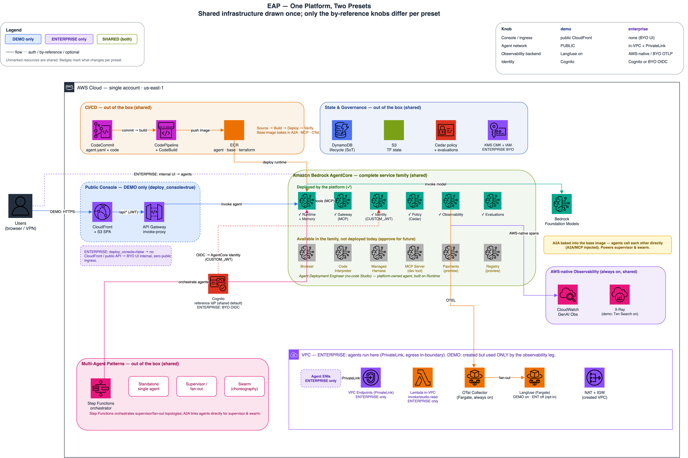
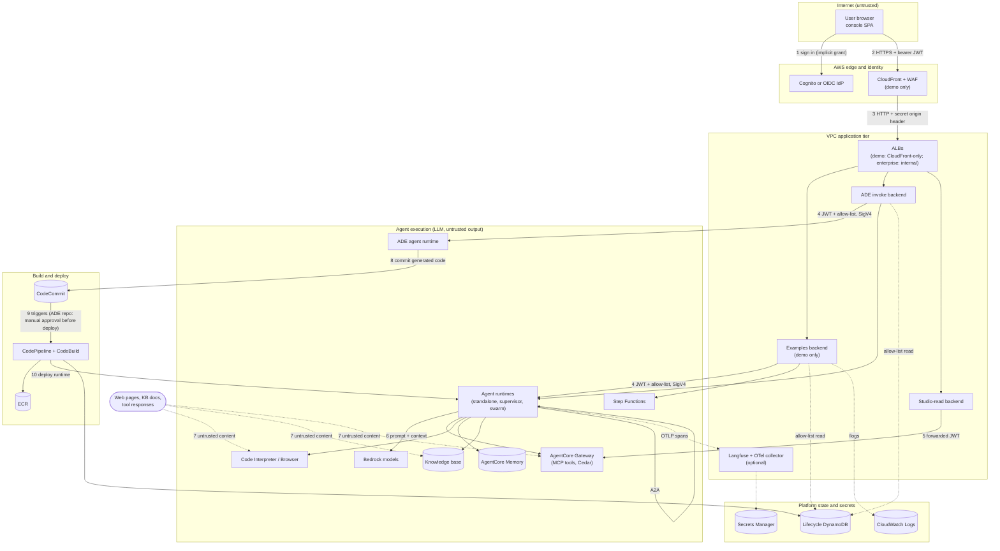

# Enterprise Agentic AI Platform (EAP) - Threat Model

> **Sample code, not for production.** SA-produced assets are not intended for a production environment. They are instructional and demonstrate the art of the possible. This threat model tells people who deploy the sample which risks exist, what the sample already does about each one, and what to change before running anything like it in production.

| | |
|---|---|
| Asset | Enterprise Agentic AI Platform (EAP), AWS sample (1:M public distribution) |
| Version | Repository `main` as of 2026-11-24 (includes ADR-046, ADR-047 and ADR-048) |
| Method | STRIDE plus the OWASP Top 10 for LLM Applications (2026 edition), built with the AWS threat-modeling MCP server and AWS threat grammar. AWS service claims were checked against the AWS documentation. |
| Status | Draft for Content Guardian review |

A threat model answers four questions: what are we building, what can go wrong, what are we going to do about it, and did we do a good enough job. The sections below follow the Simplified AWS SA Threat Model Template.

## Introduction

### Purpose

Business units want AI agents, but each team ends up rebuilding the same plumbing: identity, deployment, observability, tool access and governance. EAP is a reference implementation of a shared platform that does this once on Amazon Bedrock AgentCore. Teams describe agents in YAML, and the platform deploys and runs them with common identity, CI/CD, telemetry and policy.

The sample shows architects and builders how these pieces fit together. It is meant to be deployed for learning and demonstration, then torn down.

### Project/Asset Overview

The sample is Terraform plus application code, deployed by the user into their own AWS account (one account, one Region).

**Major components and AWS services**

- **Agent runtime:** Amazon Bedrock AgentCore Runtime hosts each agent as a container. Agents use the open-source Strands Agents SDK and talk to each other over A2A. Patterns include standalone, supervisor, swarm and sequential (AWS Step Functions).
- **Models:** Amazon Bedrock foundation models (Anthropic Claude Sonnet by default).
- **Tools and knowledge:** AgentCore Gateway exposes MCP tools, with AgentCore Policy (Cedar) for tool authorization. AgentCore Code Interpreter and Browser are available. Amazon Bedrock Knowledge Bases use an Amazon OpenSearch Serverless vector store. AgentCore Memory stores conversations.
- **Identity:** Amazon Cognito by default, or a deployer-supplied OIDC identity provider (ADR-028).
- **Console (demo preset only):** a React single-page app on Amazon S3 and Amazon CloudFront with AWS WAF, and three Amazon ECS on AWS Fargate backends behind Application Load Balancers (Examples, ADE invoke, studio-read).
- **Agent Deployment Engineer (ADE):** a platform-owned agent that turns a chat request into agent code, commits it to AWS CodeCommit and starts the deploy pipeline.
- **CI/CD:** AWS CodeCommit, AWS CodePipeline, AWS CodeBuild and Amazon ECR build agent images and run Terraform for agents, knowledge bases and gateways. An AWS Lambda function validates commits.
- **State:** an Amazon DynamoDB lifecycle table (deployed agents), Terraform state in Amazon S3, and AWS Secrets Manager.
- **Observability:** Amazon CloudWatch and AWS X-Ray always. Optionally, an OpenTelemetry collector and self-hosted Langfuse (Amazon Aurora PostgreSQL, Amazon ElastiCache for Redis and ClickHouse on Fargate).

**Deployment presets (ADR-036)**

| Preset | What it deploys |
|---|---|
| `demo` (default) | Public CloudFront console with Cognito sign-in, WAF and internet-facing ALBs that accept only CloudFront traffic. Langfuse on, with its UI behind its own CloudFront. |
| `enterprise` | No public ingress. Backends on internal ALBs for a customer-hosted UI. Langfuse off by default. Deployer-supplied OIDC is supported. |

Both presets run agents inside a VPC (`agent_network_mode = "VPC"`, the default, ADR-031) with PrivateLink endpoints and a NAT gateway for egress.

**Third-party software:** Strands Agents SDK, Langfuse v3 and ClickHouse (Docker Hub images), the AWS Distro for OpenTelemetry collector, Node.js packages (Express, `cors`, `aws-jwt-verify`, AWS SDK), and the `marked` Markdown library and `DOMPurify` HTML sanitizer in the console.

**Build and deploy:** the deployer runs Terraform with administrator credentials (`terraform apply` with `configs/demo.tfvars` or `configs/enterprise.tfvars`, or the scripted test beds in `test/`). Terraform builds the backend images locally with Docker and pushes them to ECR. Agents are then deployed by pushing YAML and code to CodeCommit, which triggers CodePipeline. Teardown is `test/*-testbed/99-teardown.sh`.

### Assumptions

| ID | Assumption | Comments |
|---|---|---|
| A-01 | The sample asset will be deployed into a non-production environment for educational purposes only. | Template assumption. Production hardening gaps are accepted for the sample, each with a production recommendation. |
| A-02 | The deployer uses a dedicated, non-production AWS account and Region with no real customer, personal or regulated data. | The sample ships synthetic example agents and documents only. This limits the impact of any compromise to sample data, the account's resources and its spend. |
| A-03 | The deployer controls and protects their AWS administrator credentials, the Terraform state bucket and the CodeCommit repositories with their own account controls (MFA, CloudTrail, no root use). | Shared responsibility model. Threats from a compromised administrator or root (TA4, TA5) are noted but out of scope. |
| A-04 | AWS service endpoints (Bedrock, AgentCore, Cognito, S3, DynamoDB) and viewer-to-CloudFront traffic use TLS 1.2 or later. | AWS-managed endpoints enforce TLS. CloudFront viewer policy is HTTPS-only. The CloudFront-to-ALB leg is plain HTTP and is modeled as T-004. |
| A-05 | The demo preset is deployed for short demonstrations and torn down afterwards. The enterprise preset is used where no public ingress is wanted. | Reduces exposure time, cost abuse and data build-up. |
| A-06 | The agents, prompts and tools in `users/` are examples. Deployers who add their own tools, data or agents are responsible for those additions' permissions and content. | Threats are modeled for the shipped examples and the platform mechanisms. |

### References

- Code Repo: `<aws-samples repository URL, once published>`
- Project Team: Vikrant Dhir (vikdhir), Principal Solutions Architect
- CSR Link: `<CSR ticket link, once created>`
- SFDC Opportunity Link: N/A (public 1:M asset)
- Other documentation:
  - Architecture decision records: [`docs/adr/README.md`](../adr/README.md), in particular ADR-028 (OIDC), ADR-031 (agents in VPC), ADR-035 (customer-managed KMS), ADR-036 (presets), ADR-037 (Examples surface), ADR-040 and ADR-041 (Fargate backends), ADR-046 and ADR-047 (backend JWT verification), ADR-048 (manual approval for ADE-generated agents)
  - Deployment runbook: [`platform/DEPLOY-RUNBOOK.md`](../../platform/DEPLOY-RUNBOOK.md)
  - [OWASP Top 10 for LLM Applications](https://genai.owasp.org/llm-top-10/) (2026 edition)
  - AWS documentation used to validate this model: [Restrict access to Application Load Balancers (CloudFront)](https://docs.aws.amazon.com/AmazonCloudFront/latest/DeveloperGuide/restrict-access-to-load-balancer.html), [Configure inbound JWT authorizer (AgentCore)](https://docs.aws.amazon.com/bedrock-agentcore/latest/devguide/inbound-jwt-authorizer.html), [OAuth 2.0 grants (Cognito)](https://docs.aws.amazon.com/cognito/latest/developerguide/federation-endpoints-oauth-grants.html), [Prompt attack filters (Bedrock Guardrails)](https://docs.aws.amazon.com/bedrock/latest/userguide/guardrails-prompt-attack.html), [Image tag mutability (ECR)](https://docs.aws.amazon.com/AmazonECR/latest/userguide/image-tag-mutability.html)

## Solution Architecture

### Architecture Diagram

Source: [`docs/diagrams/eap-architecture-combined.drawio`](../diagrams/eap-architecture-combined.drawio).

> **Diagram note:** two labels in this diagram are out of date. The "API Gateway invoke-proxy" box was replaced by ALB→Fargate backends (Examples, ADE invoke, studio-read; ADR-041), and the demo preset now also runs agents in the VPC (ADR-031). This threat model describes the current code.

**Design patterns common to the whole system**

- **User calls are authenticated with a bearer JWT.** Every console backend route verifies the token's signature, expiry and issuer against the identity provider's published keys (`aws-jwt-verify`, ADR-046 and ADR-047). `/healthz` is the only unauthenticated route.
- **Backends call AWS with their own IAM role (SigV4), never with the user's identity.** Before invoking anything, they check the target against the lifecycle DynamoDB table so only deployed runtimes and state machines can be called.
- **Public entry points (demo only) go through CloudFront and WAF.** The internet-facing ALBs accept only the CloudFront origin-facing prefix list and a random secret origin header.
- **Everything an agent runs comes from CodeCommit through CodePipeline.** Nothing is deployed to AgentCore Runtime by hand.
- **Encryption at rest uses AWS-managed keys by default.** A customer-managed KMS key can be supplied platform-wide (ADR-035).

### Data Flow Diagrams

Trust zones are shown as boxes. Numbered flows are referenced in the threats below. Dotted lines carry untrusted content or read-only access.

**Trust zones and boundary controls**

| Boundary | Crossing | Controls in the sample |
|---|---|---|
| Internet → AWS edge | Flows 1, 2 | HTTPS-only viewer policy (TLS 1.2+), WAF managed rules and a per-IP rate rule (demo), Cognito sign-in with admin-created users only |
| Edge → VPC | Flow 3 | ALB security group limited to the CloudFront origin-facing prefix list; listener forwards only requests with the secret origin header; S3 origin access control for console assets |
| Application → agent execution | Flows 4, 5 | JWT signature verification, lifecycle-table allow-list, backend task-role SigV4 |
| Agent execution → build and deploy | Flows 8, 9, 10 | ADE role can write only to the `nocode-user` repo; manual approval stage before Deploy on that repo's pipeline (ADR-048); commit-validation Lambda; evaluation gate (runs after deploy) |
| Untrusted content → agents | Flow 7 | None beyond the model's own behavior (see T-005) |
| Agent output → browser | Flows 4, 5 (responses) | Agent Markdown is sanitized with DOMPurify before it is rendered as HTML |

### Main Functionality/Use Cases of the Solution

1. **Chat with a deployed agent.** A signed-in user picks an agent in the console. The ADE invoke backend checks the token and the allow-list, then streams the agent's answer over A2A.
2. **Try the Examples gallery (demo).** A signed-in user runs the shipped standalone, swarm, supervisor and Step Functions examples and watches their logs and execution history.
3. **Build an agent from chat (ADE).** A user describes an agent. The ADE generates YAML and code and commits it to the `nocode-user` repository, which starts the pipeline. The pipeline builds the image and then waits at its Approve stage until a reviewer approves the commit in the CodePipeline console. After deployment, the console lists the new agent.
4. **Deploy agents from Git.** An agent team pushes YAML and code to its CodeCommit repository. The pipeline builds an image, deploys the runtime, runs verification and evaluations, and records the agent in the lifecycle table.
5. **Use tools and knowledge.** Agents call MCP tools through the Gateway (optionally under Cedar policy), retrieve from knowledge bases, run code, browse the web and keep memory.
6. **Observe agents.** Operators view CloudWatch, X-Ray and, optionally, Langfuse traces.

### APIs

The sample exposes HTTP APIs from three Fargate backends. All are listed in [Appendix A](#appendix-a---apis). In the demo preset they are reachable from the internet through the console's CloudFront distribution, and every route except `/healthz` requires a verified JWT. In the enterprise preset they sit on internal ALBs inside the VPC.

### Assets/Dependency

| Asset Name | Asset Usage | Data Type | Comments |
|---|---|---|---|
| User identity tokens | Cognito or OIDC ID tokens sent as bearer tokens to the backends | Confidential (credentials) | Implicit grant; stored in browser `localStorage` (T-009) |
| Prompts, attachments and agent responses | Chat content between users and agents | Internal (sample data only, A-02) | Also kept in AgentCore Memory, CloudWatch Logs, Langfuse traces and browser `localStorage` |
| Agent definitions and generated code | YAML, prompts and code in CodeCommit that the pipeline deploys | Internal | The ADE writes to `nocode-user`; teams write to their own repos |
| Container images | Agent and backend images in ECR | Internal | Platform repos use mutable tags with scan on push (T-015) |
| Platform IAM roles | Fargate task roles, AgentCore runtime roles, CodeBuild/CodePipeline roles | Restricted | Pipeline roles are broad (T-014); runtime roles use `Resource: *` for memory and peer invoke (T-013) |
| Platform secrets | Console admin password, Langfuse keys and datastore credentials, CloudFront origin secret header values | Restricted | Secrets Manager, referenced by ARN; header values also in Terraform state |
| Lifecycle records | Deployed runtime and state machine ARNs in DynamoDB | Internal | Source of the backend allow-lists |
| Conversation memory | AgentCore Memory events and extracted long-term facts | Internal | Default 90-day retention; AWS-managed key unless a CMK is supplied |
| Knowledge base content | Source documents in S3 and embeddings in OpenSearch Serverless | Internal | Retrieved into agent context |
| Telemetry and traces | CloudWatch Logs, X-Ray, OTel spans, Langfuse traces | Internal | May contain prompts and responses |
| Terraform state | Platform and per-app state in S3 | Confidential | KMS-encrypted, versioned, public access blocked |
| AWS KMS keys | Encryption at rest for S3, DynamoDB, Secrets Manager, Aurora, Redis, logs and Memory | Restricted | AWS-managed keys by default; optional customer-managed key (ADR-035) |
| AWS account spend | Bedrock tokens, AgentCore, Fargate, NAT gateway, CodeBuild | N/A | A target for abuse (T-020) |
| Third-party dependencies | Strands Agents SDK, Langfuse, ClickHouse, ADOT collector, npm and Python packages | Public | Pulled from Docker Hub, Amazon ECR Public, npm and PyPI (T-016) |

## Threats & Mitigations

SA-produced assets are not intended for a production environment, so this section takes a risk-based approach. Threats that matter for a short-lived sample deployment are fixed in the code. Production hardening gaps are accepted for the sample, and each one has a production recommendation in [Appendix B](#appendix-b---mitigations).

### Threat Actors

| Threat Actor # | Threat Actor Description |
|---|---|
| TA1 | A threat actor from the internet. No credentials. Can find the demo console's CloudFront URL and call public AWS endpoints. |
| TA2 | A threat actor acting with AWS customer permissions: an IAM principal in the deployer's account (another user or workload) that is not part of the platform. |
| TA3 | A threat actor with development team permissions: an agent developer who can push to a team CodeCommit repository, so their code gets built and deployed by the pipeline. |
| TA4 | A threat actor with admin permissions: the platform deployer or an account administrator. Trusted (A-03). |
| TA5 | A threat actor with root credentials: the AWS account root user. Out of scope (A-03). |
| TA6 | An authenticated console user: a low-privilege user with a valid Cognito or OIDC sign-in who tries to exceed their intended access, for example through prompt injection or by calling backends directly. |
| TA7 | A controller of content that agents read: someone who controls a web page the Browser tool visits, a knowledge base document or a tool response, and plants instructions in it (indirect prompt injection). |

### Threat & Mitigation Detail

Threats are written in AWS threat grammar. **Priority** is the inherent severity before mitigation. **STRIDE** also lists the OWASP Top 10 for LLM Applications (2026) category where one applies. **Decision** is Mitigate, Accept or Transfer. **Status/Notes** gives the residual-risk rationale.

**Summary:** 28 threats. 5 are mitigated in the code (T-001, T-002, T-007, T-008, T-027), 22 are accepted for the sample with a production recommendation, and 1 is the customer's responsibility. None are open.

| Threat # | Priority | Threat | STRIDE | Affected Assets | Mitigations | Decision | Status/Notes |
|---|---|---|---|---|---|---|---|
| T-001 | Critical | An internet threat actor (TA1) who knows the demo console CloudFront URL can call the Examples, ADE or studio-read APIs without signing in to invoke agents, start workflows or read agent logs, which leads to unauthorized use of agents, Bedrock spend billed to the deployer and disclosure of prompts in logs | Spoofing | Prompts and responses, Telemetry and traces, AWS spend | M-001, M-002, M-004, M-019, M-033 | Mitigate | Done. Every /examples-api, /ade-api and /api route requires a verified JWT (ADR-046/047); no self sign-up; WAF rate limit. |
| T-002 | High | An internet threat actor (TA1) who can reach a backend can forge a JWT with the platform issuer and a future expiry but no valid signature, which leads to bypass of backend authentication with the same access as a signed-in user | Spoofing | User tokens | M-001 | Mitigate | Done. aws-jwt-verify checks the signature against the IdP JWKS in all three backends; forged tokens tested locally and rejected. |
| T-003 | Medium | An internet threat actor (TA1) who discovers an internet-facing ALB DNS name in the demo preset can send requests directly to the ALB, bypassing CloudFront and WAF, which leads to loss of WAF and rate-limit protection for the backends and Langfuse | Spoofing | Platform secrets | M-003, M-006 | Accept | Accepted for the sample. Prefix list plus random secret header; header is only known to CloudFront. Production: VPC origins with internal ALBs. |
| T-004 | Medium | A threat actor with network access between CloudFront and the ALB (TA2) in the demo preset can read or modify the HTTP origin traffic, including bearer tokens and the secret origin header, which leads to token theft, spoofed origin requests and tampered agent responses | Information Disclosure | User tokens, Platform secrets | M-005, M-006 | Accept | Accepted for the sample. Origin leg stays on AWS networks between CloudFront and the ALB; sample data only (A-02). Production: HTTPS or VPC origins (M006). |
| T-005 | High | A controller of content agents read (TA7) who plants instructions in a web page, knowledge base document or tool response that an agent processes can make the agent ignore its instructions and call tools, invoke peer agents or reveal data the user did not ask for (indirect prompt injection), which leads to unauthorized tool actions and data exfiltration through the agent | Tampering / LLM01, LLM03 | Prompts and responses, KB content | M-007, M-014, M-023, M-026, M-028 | Accept | Accepted for the sample. Inherent to agentic systems; sample tools and data are synthetic (A-02, A-06); agents run in a VPC. Production: Bedrock Guardrails, scoped runtime roles, enforced Cedar (M007, M014, M028). |
| T-006 | Medium | An authenticated console user (TA6) with a valid login can use direct prompt injection or jailbreak prompts to override an agent's system prompt, which leads to harmful, off-policy or misleading output and misuse of the agent's tools | Tampering / LLM01 | Prompts and responses | M-007, M-026 | Accept | Accepted for the sample. Only signed-in, admin-created users can reach agents; sample content only; README states Guardrails are not deployed. Production: Bedrock Guardrails (M007). |
| T-007 | High | An authenticated console user or content controller (TA6, TA7) who can chat with the Agent Deployment Engineer can steer the ADE into generating malicious agent code that it commits to CodeCommit for the pipeline to build and deploy, which leads to attacker-chosen code running as an AgentCore runtime with the runtime role's permissions | Elevation of Privilege / LLM01, LLM03 | Agent definitions and code, Container images, IAM roles | M-007, M-008, M-026, M-032 | Mitigate | Done. The nocode-user pipeline stops at a manual Approve stage after Build; nothing the ADE generates is deployed until a reviewer approves it (ADR-048). |
| T-008 | High | A content controller or internet threat actor (TA7, TA1) who gets HTML or script into an agent response (for example via prompt injection) can execute script in the console because agent markdown is rendered with marked and dangerouslySetInnerHTML without sanitization, which leads to theft of the user's token from localStorage and actions performed as that user (XSS) | Elevation of Privilege / LLM10 | User tokens, Prompts and responses | M-009 | Mitigate | Done. Agent Markdown is sanitized with DOMPurify before rendering; script, event-handler and javascript: payloads tested and stripped. Production: add a CSP. |
| T-009 | Medium | A threat actor with access to the user's browser or a script running in it (TA1) after the user signs in can read the id token, which the implicit grant exposes in the URL fragment and the console stores in localStorage, which leads to session hijack until the token expires | Spoofing | User tokens | M-009, M-010, M-019 | Accept | Accepted for the sample. Tokens are short-lived and agent output is now sanitized (M009), which removes the main way to read localStorage. Production: authorization code + PKCE (M010). |
| T-010 | Medium | An authenticated user or AWS principal (TA6, TA2) holding any token from the platform user pool, such as one from a per-agent app client can invoke agent runtimes directly at the AgentCore endpoint, because the runtime JWT authorizer checks only the issuer and has no allowed audiences or clients, which leads to access to agents outside the console's allow-list and controls | Elevation of Privilege | User tokens, Prompts and responses | M-011 | Accept | Accepted for the sample. Requires a token from the platform pool (admin-created users only); backends invoke with SigV4. Production: allowed clients/audiences (M011). |
| T-011 | Medium | An authenticated console user (TA6) with a valid login can list and invoke agents deployed for other business units, because BU scoping is applied only in the browser and the allow-list is platform-wide, which leads to cross-team access to agents and their data | Elevation of Privilege | Lifecycle records, Prompts and responses | M-002, M-012 | Accept | Accepted for the sample. BU separation is demonstrated in the UI only; sample BUs are fictional. Production: server-side BU authorization (M012). |
| T-012 | Medium | An authenticated console user (TA6) using the Agent Deployment Engineer can recall another user's earlier conversation details, because ADE memory uses one fixed actor_id for all users, which leads to disclosure of other users' prompts and design details | Information Disclosure / LLM02 | Conversation memory | M-013 | Accept | Accepted for the sample. Shared ADE memory across users; acceptable with sample data only (A-02). Production: actor_id from the token sub (M013). |
| T-013 | Medium | An actor with development team permissions (TA3) who can push agent code to a team repo can deploy agent code that uses the shared runtime role (InvokeAgentRuntime and Memory APIs on all resources) to call other agents or read their memory, which leads to lateral movement between agents and disclosure of other agents' data | Elevation of Privilege / LLM03 | IAM roles, Conversation memory | M-014 | Accept | Accepted for the sample. Agent developers are trusted team members in the sample. Production: per-agent role scoping (M014). |
| T-014 | High | An actor with development team permissions (TA3) whose repo content is processed by CodeBuild can abuse the pipeline roles, which grant service-wide actions (for example lambda:*, states:*, bedrock-agentcore:*) on all resources without a permission boundary, which leads to privilege escalation from agent developer to broad control of the account's AI and serverless resources | Elevation of Privilege | IAM roles, Terraform state | M-015, M-031 | Accept | Accepted for the sample. Pipeline roles are broad to keep the sample deployable; dedicated non-production account (A-02). Production: least privilege + permission boundary (M015). |
| T-015 | Medium | An AWS principal with ECR push rights (TA2, TA3) in the deployer's account can overwrite a mutable image tag such as <agent>-latest or :latest, which leads to a tampered image running in AgentCore or ECS on the next deploy or task restart | Tampering / LLM04 | Container images | M-016, M-017 | Accept | Accepted for the sample. Requires ECR push rights in the deployer's account; scan on push. Production: immutable tags and digests (M016). |
| T-016 | Medium | A compromised upstream publisher of a third-party image or package the sample pulls (Langfuse, ClickHouse, OTel collector, npm and Python dependencies) can ship a malicious version under a floating tag or version range, which leads to malicious code in the platform's containers, several of which run as root | Tampering / LLM04 | Container images | M-017, M-018 | Accept | Accepted for the sample. Images come from official publishers; lockfiles for npm. Production: pin digests, non-root containers (M018). |
| T-017 | Medium | An actor who can add knowledge base documents (TA3, TA7) with write access to a KB source bucket or the documents it ingests can poison the knowledge base with false or instruction-bearing content, which leads to wrong answers and indirect prompt injection for every agent that retrieves it | Tampering / LLM05 | KB content | M-007, M-020 | Accept | Accepted for the sample. KB sources are deployer-controlled sample documents. Production: content review and Guardrails on retrieved text. |
| T-018 | Low | An authenticated console user (TA6) chatting with an agent that has long-term memory can plant false facts or instructions that the memory strategy extracts and later recalls, which leads to persistently manipulated agent behavior in later sessions | Tampering / LLM05 | Conversation memory | M-007, M-013 | Accept | Accepted for the sample. Sample memory, 90-day retention, short-lived demo deployments (A-05). |
| T-019 | Medium | An AWS principal with log or Langfuse access (TA2) in the deployer's account or with a Langfuse login can read prompts, responses and attachments captured in CloudWatch logs, traces, Langfuse and the browser's localStorage, which leads to disclosure of whatever users typed into agents | Information Disclosure / LLM02 | Prompts and responses, Telemetry and traces | M-021, M-031 | Accept | Accepted for the sample. No real data in the sample (A-02); log access is limited to the deployer's account. Production: redaction, retention, CMK (M021). |
| T-020 | Medium | An authenticated console user (TA6) with a valid login can drive long prompts, large attachments, swarm loops or repeated ADE builds, limited only by a per-IP WAF rate rule, which leads to unexpected Bedrock, AgentCore and CodeBuild cost and degraded service | Denial of Service / LLM06 | AWS spend | M-004, M-019, M-022, M-033 | Accept | Accepted for the sample. Admin-created users only, WAF rate limit, teardown after use (A-05). Production: budgets, quotas, token caps (M022). |
| T-021 | Low | An authenticated console user (TA6) chatting with any agent can extract system prompts, tool definitions or internal resource names, which leads to knowledge that helps craft other attacks | Information Disclosure / LLM08 | Prompts and responses | M-007, M-024 | Accept | Accepted for the sample. Prompts are public in the repo and hold no secrets. |
| T-022 | Low | An authenticated console user (TA6) querying a knowledge-base agent can retrieve documents ingested for another team, because vector stores are not partitioned per user or BU, which leads to cross-team disclosure of KB content | Information Disclosure / LLM09 | KB content | M-012, M-025 | Accept | Accepted for the sample. Sample KB documents are public examples. Production: per-BU KBs or metadata filters (M025). |
| T-023 | Low | A user who relies on agent output (TA6) acting on an answer from an example agent can take action on incorrect or fabricated guidance (for example architecture or cost advice), which leads to poor decisions based on misinformation | Tampering / LLM07 | Prompts and responses | M-026 | Accept | Accepted for the sample. README disclaimer and an accurate safety section; outputs are examples. Users must review agent output. |
| T-024 | Low | An authenticated console user (TA6) who triggers agent actions or ADE deploys can deny having done so, because downstream actions run as service roles and ADE commits are authored as 'Agent Deployment Engineer', which leads to inability to attribute agent actions and deployments to a person | Repudiation | Agent definitions and code | M-027 | Accept | Accepted for the sample. CloudTrail records service-role actions; sample has few users. Production: propagate user identity (M027). |
| T-025 | Medium | An agent developer or console user (TA3, TA6) calling Gateway tools can use tools that the Cedar policies in users/governance are meant to forbid, because Terraform does not associate the policy engine with the Gateway, which leads to tool authorization weaker than documented | Elevation of Privilege / LLM03 | Prompts and responses | M-028 | Accept | Accepted for the sample. Terraform cannot attach the Cedar engine yet. The README now states Cedar is not enforced by default and gives the manual attach command; sample tools are synthetic (A-06). Production: attach and verify (M028). |
| T-026 | Medium | An internet threat actor (TA1) who finds the demo Langfuse CloudFront URL can attack the Langfuse login, which is the only control on its UI apart from WAF, which leads to disclosure of all traces, including prompts and responses | Spoofing / LLM02 | Telemetry and traces | M-003, M-004, M-029 | Accept | Accepted for the sample. Demo only; WAF, secret header and Langfuse login. Enterprise keeps Langfuse internal. |
| T-027 | Low | An AWS principal with S3 read access (TA2) in the deployer's account can read Terraform state, which holds generated values such as datastore passwords, which leads to disclosure of platform secrets | Information Disclosure | Terraform state, Platform secrets | M-030, M-031 | Mitigate | Done. State bucket is KMS-encrypted, versioned and blocks public access. |
| T-028 | High | An actor with admin or root credentials (TA4, TA5) in the deployer's account can disable or change any platform control, read any data, or delete the platform, which leads to full compromise of the sample deployment | Elevation of Privilege | IAM roles, Platform secrets, Terraform state | M-031 | Transfer | Customer responsibility. Account administration and root are the deployer's responsibility (A-03); the platform cannot defend against them. |

**OWASP Top 10 for LLM Applications (2026) coverage**

| OWASP category | Threats | Sample posture |
|---|---|---|
| LLM01 Prompt Injection | T-005, T-006, T-007 | T-007 mitigated: ADE-generated code needs a reviewer's approval before deploy. T-005 and T-006 accepted; no Bedrock Guardrails, which production should add. |
| LLM02 Sensitive Information Disclosure | T-012, T-019, T-026 | Accepted with sample data only. Production: per-user memory, redaction, retention. |
| LLM03 Excessive Agency | T-005, T-007, T-013, T-025 | Runtime roles are broad; Cedar policies are created but must be attached to the Gateway manually (T-025, documented in the README). |
| LLM04 Supply Chain | T-015, T-016 | Scan on push and lockfiles; floating tags and root containers accepted. |
| LLM05 Data and Model Poisoning | T-017, T-018 | KB content is deployer-controlled; memory poisoning accepted. Models are AWS-managed (no custom training). |
| LLM06 Unbounded Consumption | T-020 | Sign-in required, WAF rate limit, teardown after use. |
| LLM07 Misinformation | T-023 | Disclaimer; users must review output. |
| LLM08 Hidden Context Exposure | T-021 | Prompts are public in the repo and contain no secrets. |
| LLM09 Vector and Embedding Weaknesses | T-022 | KBs are not partitioned per BU; accepted for sample documents. |
| LLM10 Improper Output Handling | T-008 | Mitigated: agent Markdown is sanitized with DOMPurify before rendering. Production: add a Content-Security-Policy header. |

**Fixed before publishing**

These three items were open in the first draft of this model and are now addressed:

1. **T-008, unsanitized agent output in the console.** `MarkdownView` in `platform/console/src/components/ChatRenderer.tsx` (also used by `UnifiedAgentView.tsx`) now sanitizes the HTML with DOMPurify and renders the result as React elements, with no `dangerouslySetInnerHTML`. Script tags, event handlers, `javascript:` links, iframes, forms and inline styles were tested and are removed; normal Markdown still renders.
2. **T-007, ADE-generated code deploying without review.** The `nocode-user` pipeline now has an Approve stage between Build and Deploy (ADR-048). The ADE tells the user the deploy is waiting for approval.
3. **T-025, Cedar policies described as enforced.** The README's "LLM Safety and Guardrails" section now states which controls are active, that Bedrock Guardrails are not deployed, and that the Cedar policy engine must be attached to the Gateway manually, with the command.

**Most important production recommendations**

If you build on this sample, start with these: Amazon Bedrock Guardrails on input, retrieved content and output (M-007); attach and verify Cedar enforcement (M-028); least-privilege pipeline and runtime roles with a permission boundary (M-014, M-015); server-side business-unit authorization (M-012); per-user memory (M-013); HTTPS or VPC origins behind CloudFront (M-006); and the authorization code grant with PKCE (M-010).

## APPENDIX A - APIs

| API | Method | Status | Mutating/Non-Mutating | Functionality | Callable from Internet | Authorized Callers | Comments |
|---|---|---|---|---|---|---|---|
| `/healthz` (each backend) | GET | New | Non-Mutating | ALB health check | Demo: no (ALB requires the CloudFront secret header) | Any | Returns service name only |
| `/examples-api/invoke` | POST | New | Mutating | Streams an A2A `message/stream` call to a deployed agent runtime (SSE) | Demo: yes, via CloudFront | Signed-in users (console app client JWT) | Target must be in the lifecycle table (ADR-046). Demo only. |
| `/examples-api/sfn/start` | POST | New | Mutating | Starts a Step Functions execution with a query | Demo: yes | Signed-in users | State machine must be in the lifecycle table |
| `/examples-api/sfn/status` | GET | New | Non-Mutating | Describes an execution | Demo: yes | Signed-in users | Execution must belong to an allowed state machine |
| `/examples-api/sfn/history` | GET | New | Non-Mutating | Execution history and reconstructed A2A pairs | Demo: yes | Signed-in users | Same as above |
| `/examples-api/logs` | GET | New | Non-Mutating | Recent AgentCore runtime logs for a runtime prefix | Demo: yes | Signed-in users | Prefix must be a plain identifier; any platform runtime's logs are readable (T-019) |
| `/ade-api/invoke` | POST | New | Mutating | Streams a chat turn to the ADE or an allow-listed deployed agent | Demo: yes. Enterprise: VPC only | Signed-in users (any client of the pool) | The ADE can commit code and start the `nocode-user` pipeline, which waits for manual approval before deploying (T-007) |
| `/api/my-deployed-agents` | GET | New | Non-Mutating | Lists deployed apps | Demo: yes. Enterprise: VPC only | Signed-in users | Not filtered by business unit (T-011) |
| `/api/deployment-status/:executionId` | GET | New | Non-Mutating | Pipeline execution status | Same | Signed-in users | |
| `/api/resolve-pattern` | GET | New | Non-Mutating | Reads an app's `application.yaml` pattern | Same | Signed-in users | |
| `/api/latest-deployment` | GET | New | Non-Mutating | Latest pipeline execution | Same | Signed-in users | |
| `/api/gateway` | POST | New | Mutating | Proxies an MCP call to AgentCore Gateway with the user's JWT | Same | Signed-in users; the Gateway CUSTOM_JWT authorizer also checks the token when configured | Tool authorization depends on Cedar (T-025) |
| `/api/agent-card` | GET | New | Non-Mutating | Fetches an agent's A2A agent card | Same | Signed-in users | |
| `/api/config` | GET | New | Non-Mutating | Console runtime configuration (Cognito client ID, domain) | Same | Signed-in users | |
| AgentCore `InvokeAgentRuntime` | POST | Not in scope | Mutating | AWS API to invoke a runtime | AWS public endpoint | IAM SigV4, or a JWT from the platform issuer when OIDC is configured | Runtime JWT authorizer has no allowed audiences or clients (T-010) |
| AgentCore Gateway MCP endpoint | POST | Not in scope | Mutating | MCP tool calls | AWS public endpoint | CUSTOM_JWT authorizer | |
| Langfuse UI and API | GET/POST | Not in scope | Mutating | Trace UI and OTLP ingestion | Demo: yes, via its own CloudFront. Enterprise: VPC only | Langfuse application login; OTLP from in-VPC collector | Third-party application (T-026) |

## APPENDIX B - Mitigations

"Implemented in the sample" mitigations are in the code today, with the file references shown. "Not in the sample" mitigations are production recommendations; the sample accepts the related risk under assumption A-01.

| Mitigation Number | Mitigation Description | Threats Mitigating | Status / If not complete, link a ticket | Related BSC | Comments |
|---|---|---|---|---|---|
| M-001 | Verify the caller's JWT signature, expiry and issuer on every backend route (aws-jwt-verify against the IdP JWKS) | T-001, T-002 | Implemented in the sample |  | examples-backend/src/auth.ts, ade-invoke-backend/src/auth.ts, studio-read-backend/src/auth.ts; ADR-046, ADR-047. Examples also requires the console app client. |
| M-002 | Allow-list invocation targets against the lifecycle table (only deployed runtimes and state machines) | T-001, T-011 | Implemented in the sample |  | examples-backend/src/allowList.ts; ade-invoke-backend/src/runtimeAllowList.ts. |
| M-003 | Lock internet-facing ALBs to CloudFront: security group allows only the CloudFront origin-facing prefix list, and the listener forwards only requests carrying a random secret origin header | T-003, T-026 | Implemented in the sample |  | examples-console/main.tf (aws_security_group.alb, aws_lb_listener_rule.cloudfront_only); same pattern in ade/studio-read/langfuse modules. |
| M-004 | AWS WAF on CloudFront with AWS Common and KnownBadInputs managed rule groups and a 2000-requests-per-5-minutes per-IP rate rule | T-001, T-020, T-026 | Implemented in the sample |  | examples-console/main.tf aws_wafv2_web_acl.cloudfront, attached to the console and Langfuse distributions. |
| M-005 | HTTPS-only viewer policy with TLS 1.2 minimum on CloudFront; TLS to all AWS service endpoints | T-004 | Implemented in the sample |  | console/main.tf viewer_protocol_policy https-only, minimum_protocol_version TLSv1.2_2021. |
| M-006 | Production: use HTTPS from CloudFront to origins (ACM certificate on the ALB) or CloudFront VPC origins with internal ALBs | T-003, T-004 | Not in the sample (production recommendation) |  | AWS recommends requiring HTTPS in addition to the secret header, and VPC origins for private ALBs (CloudFront Developer Guide: Restrict access to Application Load Balancers). The enterprise preset already keeps ALBs internal. |
| M-007 | Production: apply Amazon Bedrock Guardrails (prompt-attack filter, content and denied-topic filters) to user input, retrieved content and model output | T-005, T-006, T-007, T-017, T-018, T-021 | Not in the sample (production recommendation) |  | Configure a guardrail and pass it on InvokeModel/Converse or call ApplyGuardrail on tool results (Bedrock User Guide: prompt attack filters). |
| M-008 | Require human approval of ADE-generated changes before deploy: CodePipeline manual approval stage (Approve) between Build and Deploy on the nocode-user pipeline (ADR-048) | T-007 | Implemented in the sample |  | modules/pipeline/main.tf dynamic stage Approve (require_manual_approval); eap-platform/variables.tf and pipelines/main.tf set it true for nocode-user-deploy. Production: also run evaluations before Deploy in a staging runtime. |
| M-009 | Sanitize agent Markdown with DOMPurify before rendering it as HTML (scripts, event handlers, javascript: URLs, iframes, forms and inline styles removed; links get rel=noopener) | T-008, T-009 | Implemented in the sample |  | platform/console/src/components/ChatRenderer.tsx MarkdownView (used by ChatRenderer and UnifiedAgentView). Production: also add a Content-Security-Policy response header on CloudFront. |
| M-010 | Production: use the authorization code grant with PKCE and keep tokens in memory instead of localStorage | T-009 | Not in the sample (production recommendation) |  | Cognito documents the implicit grant as legacy and the authorization code grant as the most secure (Cognito Developer Guide: OAuth 2.0 grants). |
| M-011 | Production: configure allowed clients or audiences on the AgentCore runtime JWT authorizer | T-010 | Not in the sample (production recommendation) |  | Set allowed_clients/allowed_audience in modules/pipeline/deploy-template/main.tf oidc_authorizer_config (AgentCore Developer Guide: Configure inbound JWT authorizer). |
| M-012 | Production: enforce business-unit and persona authorization server-side from token claims (cognito:groups) on every backend route | T-011, T-022 | Not in the sample (production recommendation) |  | Filter lifecycle records and allow-lists by the caller's BU group in the backends. |
| M-013 | Production: key AgentCore Memory by the caller's identity (actor_id from the verified token sub) | T-012, T-018 | Not in the sample (production recommendation) |  | Pass the user sub as ACTOR_ID/actor in studio/app/main.py and the agent base image instead of a fixed value. |
| M-014 | Production: scope each agent's runtime role to its own memory and its declared callees instead of Resource '*' | T-005, T-013 | Not in the sample (production recommendation) |  | Replace AgentCoreMemory and AgentCoreInvokePeers statements in modules/pipeline/deploy-template/main.tf with per-agent ARNs. |
| M-015 | Production: least-privilege pipeline roles plus an IAM permission boundary on every role the pipeline creates | T-014 | Not in the sample (production recommendation) |  | Replace service:* and Resource '*' grants in modules/pipeline, kb-pipeline, qa-pipeline, governance-pipeline, gateway-pipeline. |
| M-016 | Production: enable ECR tag immutability and deploy images by digest | T-015 | Not in the sample (production recommendation) |  | image_tag_mutability = IMMUTABLE on platform repos (ECR User Guide: image tag mutability); reference image@sha256 in runtimes and task definitions. |
| M-017 | Scan images on push to ECR, lock npm dependencies with package-lock.json, and run the Strands agent base image as a non-root user | T-015, T-016 | Implemented in the sample |  | scan_on_push = true on all ECR repos; base-images/strands Dockerfile USER appuser. |
| M-018 | Production: pin third-party images by digest, run all containers as non-root, and scan dependencies in CI | T-016 | Not in the sample (production recommendation) |  | Langfuse, ClickHouse and OTel images in modules/observability; node backends and Studio Dockerfiles. |
| M-019 | Cognito user pool allows admin-created users only (no self sign-up), enforces a password policy, and seeds the admin password randomly into Secrets Manager | T-001, T-009, T-020 | Implemented in the sample |  | eap-platform/identity/main.tf allow_admin_create_user_only = true, password_policy. |
| M-020 | Knowledge base content enters only through the KB pipeline from deployer-controlled S3/CodeCommit; source buckets are private | T-017 | Implemented in the sample |  | modules/kb-pipeline, deploy-templates/kb-deploy. |
| M-021 | Production: redact sensitive fields in logs and traces, set short log retention, use a customer-managed KMS key, and clear chat history from browser storage | T-019 | Partly in the sample |  | kms_key_arn is supported platform-wide (ADR-035); log_group_retention_days is configurable. |
| M-022 | Production: AWS Budgets alerts and Cost Anomaly Detection, per-user quotas and max-token limits on agents | T-020 | Not in the sample (production recommendation) |  | Add budgets in the deployer account; cap tokens in agent config. |
| M-023 | Enterprise preset runs agents in a VPC with no public ingress; Code Interpreter and Browser run in AgentCore-managed sandboxes | T-005 | Implemented in the sample |  | configs/enterprise.tfvars deploy_console=false, agent_network_mode=VPC (ADR-031, ADR-036). |
| M-024 | Keep secrets and credentials out of system prompts and tool descriptions | T-021 | Implemented in the sample |  | Shipped prompts in users/ contain no secrets; credentials come from IAM roles and AgentCore Identity. |
| M-025 | Production: partition knowledge bases per BU or apply metadata filters on retrieval | T-022 | Not in the sample (production recommendation) |  | One KB per team, or metadata filtering in Retrieve calls. |
| M-026 | Document that the sample is non-production, state accurately which safety controls are active, and that agent output and generated code need human review | T-005, T-006, T-007, T-023 | Implemented in the sample |  | README top notice and corrected 'LLM Safety and Guardrails' section; this threat model. |
| M-027 | Production: carry the end-user identity into downstream actions (commit author, log fields) and enable CloudTrail data events | T-024 | Not in the sample (production recommendation) |  | Pass the verified token sub through the ADE to pipeline_trigger and log it in backends. |
| M-028 | Document the manual step to attach the Cedar policy engine to the Gateway, state in the README that it is not enforced by default, and verify enforcement after attaching it | T-005, T-025 | Partly in the sample |  | README 'LLM Safety and Guardrails' table; modules/gateway/main.tf comment with the update-gateway command. Production: attach and verify, or automate once the Terraform provider supports it. |
| M-029 | Langfuse is internal-only by default; in the demo preset it sits behind its own CloudFront with WAF, the secret origin header and Langfuse's application login | T-026 | Implemented in the sample |  | modules/observability/langfuse (ADR-030, ADR-039). |
| M-030 | Terraform state and secrets are stored encrypted in private AWS stores (S3 state bucket, Secrets Manager referenced by ARN) | T-027 | Implemented in the sample |  | eap-platform/state-backend; ECS secrets valueFrom in langfuse/main.tf. |
| M-031 | Deployer secures the AWS account: MFA, no root use, CloudTrail, a dedicated non-production account (assumptions A-02, A-03) | T-014, T-019, T-027, T-028 | Customer responsibility |  | Customer responsibility under the shared responsibility model. |
| M-032 | ADE runtime role can write only to the dedicated nocode-user CodeCommit repo, isolating ADE-generated agents from team repos | T-007 | Implemented in the sample |  | modules/pipeline/deploy-template/main.tf CodeCommitForStudio statement scoped to repository/nocode-user. |
| M-033 | Tear down the demo preset after use (99-teardown.sh) to limit exposure time and cost | T-001, T-020 | Implemented in the sample |  | test/demo-testbed/99-teardown.sh; assumption A-05. |
